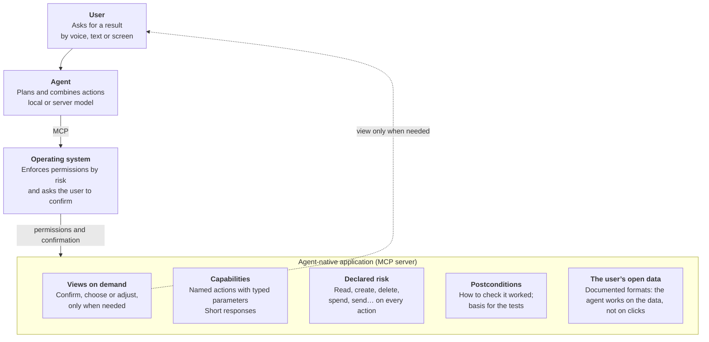

# Falken — Manifesto for agent-native applications

*Draft · October 2026 · Carlos Carrillo · [Versión en español](MANIFIESTO.md)*

Draft. In an operating system with an AI agent, applications stop being screens full of buttons and become capabilities the agent uses on the user’s behalf. This manifesto sets out the principles of those applications, for AIOS and newos and for any system that wants to adopt them.

The standard is called **Falken**, after Professor Falken, creator of the AI in *WarGames* (1983), the film that inspires the look of AIOS. Subtitle: *the agent-native application profile*.

## The shift: from opening applications to asking for results

For forty years, using a computer has meant translating what we want into a sequence of clicks: open the application, find the menu, fill in the form. The graphical interface was the best way to make the machine accessible to people who could not program it. With an AI agent in the operating system, the machine does that translation: the user says what they want and the agent gets it done.

That changes what an application is. It is no longer, first of all, a screen; it is **a set of well-defined capabilities over some data**, which the agent combines to deliver what the user asks for. The screen still exists, but its role changes: it stops being the way in and becomes a surface to confirm, choose and fine-tune.

Buttons do not disappear completely. Direct manipulation is still better for spatial adjustments (cropping a photo, placing an element), for comparing many options at a glance, for quick repeated actions and for places where you cannot speak. The paradigm is not “no interface”; it is **intent first, interface on demand**.

The major platforms are already moving in this direction, but each with its own closed mechanism. This manifesto proposes common, open foundations so that an application written once works well with any agent, on any system, including small models running offline on modest hardware.

## Principles

An agent-native application follows these ten principles. Each one solves a concrete problem that appears when an agent, not a person, is the one using the application.

1. **Capabilities before screens.** The application declares what it can do: named actions, a short description and typed parameters. Everything that can be done through its interface can also be done through its capabilities.
2. **The data belongs to the user and is in plain sight.** The application stores its documents in open, documented formats. The agent works on the data, not by simulating clicks on an interface.
3. **Every action declares its risk.** Read, create, modify, delete, spend money, send to third parties: each capability states its category, and the operating system, not the model, enforces permissions and asks for confirmation when needed.
4. **Irreversible actions are confirmed with the user.** A destructive action does not run on the first call: it returns what it is about to do and waits for an explicit yes from the user. The agent cannot confirm on its own.
5. **Every action can be verified.** Alongside each capability, the application provides a way to check that it worked (its postcondition). The agent does not claim what has not happened, and results can be measured and improved.
6. **Everything is logged and can be audited.** Every action leaves a record: what the user asked for, which capability the agent used and with which parameters, what was confirmed and by whom, and what the verification returned. The log belongs to the user, is kept on their device, reads in plain language, and the agent cannot modify or delete it. Secrets (passwords, keys) are never written to it. When the action allows it, the log also makes it possible to undo it. And it can be exported in open formats ([OCSF](https://venturebeat.com/ai/ocsf-explained-the-shared-data-language-security-teams-have-been-missing) for auditing and security, OpenTelemetry for observability), so any organisation can bring it into its own tools.
7. **Short, stable responses.** Compact, structured results, errors with stable codes and a hint for the next step. What works for a 4-billion-parameter model works for any larger model.
8. **Interface on demand.** The application may offer views to confirm, choose or adjust, which the system shows only when they are needed. The view and the capability do the same thing: no functions hidden behind buttons alone.
9. **Any modality.** The same result must be able to be spoken, read as text or shown on screen. The application indicates what is essential in each response.
10. **Local first.** Capabilities work offline whenever the task allows. Anything that needs the network, or sends data off the device, declares it.

## Anatomy of an agent-native application

An application has five parts, and the screen is just one of them, and optional.

The agent never touches the application directly: it goes through the operating system, which enforces permissions according to the declared risk of each action. The view only reaches the user when there is something to confirm, choose or adjust.

## Relationship to MCP and other standards

This standard is not a new protocol: it is built on MCP as a profile, an extension. MCP already solves how an agent discovers and calls tools, has neutral governance (since December 2025 it lives in the Agentic AI Foundation, within the Linux Foundation) and is used by the major platforms. Competing with it would be a mistake; completing it is the opportunity.

| Standard | What it solves | What it lacks for this case |
| --- | --- | --- |
| [MCP](https://www.anthropic.com/news/donating%2Dthe%2Dmodel%2Dcontext%2Dprotocol%2Dand%2Destablishing%2Dof%2Dthe%2Dagentic%2Dai%2Dfoundation) | Discovering and calling tools; open, neutral protocol | Per-action risk, confirmation, verification, auditing, open data |
| [MCP Apps](https://blog.modelcontextprotocol.io/posts/2026-01-26-mcp-apps/) | Interactive interfaces served by the tool (January 2026) | When to show a view and how it maps to the capabilities |
| AGENTS.md | Instructions for agents inside a code repository | Designed for code, not for user applications |
| [Android AppFunctions](https://android-developers.googleblog.com/2026/02/the-intelligent-os-making-ai-agents.html?hl=be) | Local functions that apps expose to the system agent | Closed to Android and its agent |
| Apple App Intents | App actions for Siri and Shortcuts | Closed to Apple platforms |
| [OpenVerb](https://github.com/sgthancel/openverb) | JSON verb libraries that describe an app's actions for AI (2025) | User confirmation, postconditions, auditing, open data |

**What this standard adds** are the conventions MCP leaves open: risk categories, the confirmation cycle, verifiable postconditions, the audit log, data in open formats, compact responses and modality hints. An application that follows it is an ordinary MCP server: any MCP-compatible agent can use it, and an agent that knows the profile uses it better and more safely.

## Project commitments

For other systems to adopt it, the standard has to be truly open and prove it works before asking anyone to use it.

- **Open licence:** the specification under CC BY 4.0 and the reference code under MIT or Apache 2.0, so anyone can implement it, including in commercial products.
- **Reference implementation:** AIOS and newos are the first systems to follow it. Their applications show how to build for it, and their agent shows how to use it.
- **Developer tools:** a validator that checks whether an application follows the profile and a conformance test suite, reusing the verifiers from the AIOS benchmark.
- **A specification drawn from practice:** v0.1 is written from real applications that work, not the other way round.
- **Open governance:** changes by public proposal and discussion in the repository. If it gains traction, it is proposed to the MCP community as an official extension, so that its governance sits with the Agentic AI Foundation and does not depend on a single project.

## Next steps

The standard moves forward as a light, parallel thread, without delaying the AIOS milestones or the use of the Lambda credits.

1. **Now:** review and close this manifesto; publish it in its own repository.
2. **AIOS milestones 1–2:** build 3 or 4 applications following the principles (documents, notes, media, system settings) and record what works and what does not.
3. **After milestone 2:** write specification v0.1 from those applications, with the validator and the conformance tests.
4. **Once v0.1 is published:** make it known and find a second system or agent to implement it; with traction, propose it to the MCP community.

**Open questions**

- [ ] Name: Falken. Still to check that a GitHub organisation and a domain are available.
- [ ] Language of the specification: English for adoption, with a Spanish version.
- [ ] Closed list of risk categories, and who decides the category of each action.
- [ ] How to describe a postcondition so that a program can check it, not just a model.
- [ ] Which open format each type of data uses (documents, notes, calendar, contacts).
