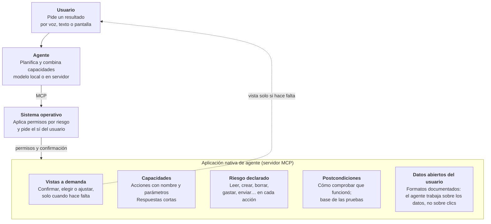

# Falken — Manifiesto de las aplicaciones nativas de agente

*Borrador · octubre de 2026 · Carlos Carrillo · [English version](MANIFESTO.md)*

Borrador. En un sistema operativo con un agente de IA, las aplicaciones dejan de ser pantallas llenas de botones y pasan a ser capacidades que el agente usa en nombre del usuario. Este manifiesto fija los principios de esas aplicaciones, para AIOS y newos y para cualquier sistema que quiera adoptarlos.

El estándar se llama **Falken**, por el profesor Falken, creador de la IA de *WarGames* (1983), la película que inspira la estética de AIOS. Subtítulo: *el perfil de las aplicaciones nativas de agente*.

## El cambio: de abrir aplicaciones a pedir resultados

Durante cuarenta años, usar un ordenador ha significado traducir lo que queremos a una secuencia de clics: abrir la aplicación, encontrar el menú, rellenar el formulario. La interfaz gráfica fue la mejor forma de hacer accesible la máquina a quien no sabía programarla. Con un agente de IA en el sistema operativo, esa traducción la hace la máquina: el usuario dice qué quiere y el agente lo consigue.

Eso cambia lo que es una aplicación. Ya no es, ante todo, una pantalla; es **un conjunto de capacidades bien definidas sobre unos datos**, que el agente combina para cumplir lo que el usuario pide. La pantalla sigue existiendo, pero cambia de papel: deja de ser la puerta de entrada y pasa a ser una superficie para confirmar, elegir y afinar.

Los botones no desaparecen del todo. La manipulación directa sigue siendo mejor para ajustes espaciales (recortar una foto, colocar un elemento), para comparar muchas opciones de un vistazo, para acciones rápidas que se repiten y para entornos donde no se puede hablar. El paradigma no es "sin interfaz", es **intención primero, interfaz bajo demanda**.

Las grandes plataformas ya se mueven en esta dirección, pero cada una con su mecanismo propio y cerrado. Este manifiesto propone las bases comunes y abiertas para que una aplicación escrita una vez funcione bien con cualquier agente, en cualquier sistema, también con modelos pequeños que corren sin red en hardware modesto.

## Menos capas, no más

Los sistemas operativos de hoy son capas sobre capas. Cada aplicación trae su propio mundo: su kit de interfaz, sus menús y asistentes, su panel de ajustes, su sistema de ayuda, su actualizador, su gestión de permisos y su registro de errores. Multiplicado por cientos de aplicaciones, y sumado a décadas de capas de compatibilidad, el resultado son sistemas que necesitan 16 GB de memoria para abrir un procesador de textos.

Cuando es el agente quien usa las aplicaciones, buena parte de esas capas se puede quitar o llevar al sistema operativo, que las ofrece **una sola vez para todas**: permisos, confirmaciones, registro de auditoría, voz y presentación de vistas. Cada aplicación queda reducida a lo esencial: sus capacidades y sus datos.

No todas las capas sobran. Los controladores del hardware, el aislamiento entre programas y la seguridad existen por buenas razones y se quedan. Lo que sobra es la duplicación, y la complejidad pensada solo para que una persona navegue por menús.

Menos capas no es una preferencia estética: es lo que permite que un sistema completo, con un agente de IA local, funcione en un portátil de hace años con 8 GB de memoria. Y Falken se aplica su propia regla: es un perfil fino sobre MCP, no una capa más.

## Principios

Una aplicación nativa de agente cumple estos once principios. Cada uno resuelve un problema concreto que aparece cuando un agente, y no una persona, es quien usa la aplicación.

1. **Capacidades antes que pantallas.** La aplicación declara qué sabe hacer: acciones con nombre, una descripción corta y parámetros tipados. Todo lo que se puede hacer con su interfaz se puede hacer también con sus capacidades.
2. **Los datos son del usuario y están a la vista.** La aplicación guarda sus documentos en formatos abiertos y documentados. El agente trabaja sobre los datos, no simulando clics sobre una interfaz.
3. **Cada acción declara su riesgo.** Leer, crear, modificar, borrar, gastar dinero, enviar a terceros: cada capacidad dice a qué categoría pertenece, y el sistema operativo, no el modelo, aplica los permisos y pide confirmación cuando toca.
4. **Lo irreversible se confirma con el usuario.** Una acción destructiva no se ejecuta a la primera: devuelve qué va a hacer y espera un sí explícito del usuario. El agente no puede confirmar por su cuenta.
5. **Cada acción se puede verificar.** Junto a cada capacidad, la aplicación ofrece cómo comprobar que funcionó (su postcondición). Así el agente no afirma lo que no ha ocurrido, y los resultados se pueden medir y mejorar.
6. **Todo queda registrado y se puede auditar.** Cada acción deja un registro: qué pidió el usuario, qué capacidad usó el agente y con qué parámetros, qué se confirmó y quién lo hizo, y qué dio la verificación. El registro pertenece al usuario, se guarda en su equipo, se lee en lenguaje claro y el agente no puede modificarlo ni borrarlo. Los secretos (contraseñas, claves) nunca se escriben en él. Cuando la acción lo permite, el registro sirve también para deshacerla. Y se puede exportar en formatos abiertos ([OCSF](https://venturebeat.com/ai/ocsf-explained-the-shared-data-language-security-teams-have-been-missing) para auditoría y seguridad, OpenTelemetry para observabilidad), de modo que cualquier organización lo lleve a sus propias herramientas.
7. **Respuestas cortas y estables.** Resultados compactos y estructurados, errores con código estable y una pista del siguiente paso. Lo que funciona para un modelo de 4.000 millones de parámetros funciona para cualquier modelo mayor.
8. **Interfaz bajo demanda.** La aplicación puede ofrecer vistas para confirmar, elegir o ajustar, que el sistema muestra solo cuando hacen falta. La vista y la capacidad hacen lo mismo: no hay funciones escondidas solo en los botones.
9. **Cualquier modalidad.** El mismo resultado debe poder decirse por voz, leerse en texto o mostrarse en pantalla. La aplicación indica qué es lo esencial de cada respuesta.
10. **Local primero.** Las capacidades funcionan sin conexión siempre que la tarea lo permita. Lo que necesite red, o enviar datos fuera del equipo, lo declara.
11. **Usa los servicios del sistema, no traigas los tuyos.** La aplicación delega en el sistema operativo los permisos, la confirmación, el registro, la voz y la presentación de vistas, en lugar de incluir sus propias versiones. Así cada aplicación es más pequeña, y todas se comportan igual ante el usuario.

## Anatomía de una aplicación nativa de agente

Una aplicación tiene cinco partes, y la pantalla es solo una de ellas, opcional.

El agente nunca toca la aplicación directamente: pasa por el sistema operativo, que aplica los permisos según el riesgo declarado de cada acción. La vista solo aparece ante el usuario cuando hay algo que confirmar, elegir o ajustar.

## Relación con MCP y otros estándares

Este estándar no es un protocolo nuevo: se construye sobre MCP como un perfil, una extensión. MCP ya resuelve cómo un agente descubre y llama herramientas, tiene gobernanza neutral (desde diciembre de 2025 vive en la Agentic AI Foundation, dentro de la Linux Foundation) y lo usan las grandes plataformas. Competir con él sería un error; completarlo es la oportunidad.

| Estándar | Qué resuelve | Qué le falta para este caso |
| --- | --- | --- |
| [MCP](https://www.anthropic.com/news/donating%2Dthe%2Dmodel%2Dcontext%2Dprotocol%2Dand%2Destablishing%2Dof%2Dthe%2Dagentic%2Dai%2Dfoundation) | Descubrir y llamar herramientas; protocolo abierto y neutral | Riesgo por acción, confirmación, verificación, auditoría, datos abiertos |
| [MCP Apps](https://blog.modelcontextprotocol.io/posts/2026-01-26-mcp-apps/) | Interfaces interactivas servidas por la herramienta (enero 2026) | Cuándo mostrar una vista y cómo equivale a las capacidades |
| AGENTS.md | Instrucciones para agentes dentro de un repositorio de código | Pensado para código, no para aplicaciones de usuario |
| [Android AppFunctions](https://android-developers.googleblog.com/2026/02/the-intelligent-os-making-ai-agents.html?hl=be) | Funciones locales que las apps exponen al agente del sistema | Cerrado a Android y a su agente |
| Apple App Intents | Acciones de apps para Siri y Atajos | Cerrado a las plataformas de Apple |
| [OpenVerb](https://github.com/sgthancel/openverb) | Bibliotecas de verbos en JSON que describen las acciones de una app para la IA (2025) | Confirmación del usuario, postcondiciones, auditoría, datos abiertos |

**Lo que añade este estándar** son las convenciones que MCP deja abiertas: categorías de riesgo, el ciclo de confirmación, las postcondiciones verificables, el registro de auditoría, los datos en formatos abiertos, las respuestas compactas y las pistas de modalidad. Una aplicación que lo cumple es un servidor MCP normal: cualquier agente compatible con MCP puede usarla, y un agente que conozca el perfil la usa mejor y con más seguridad.

## Compromisos del proyecto

Para que otros sistemas lo adopten, el estándar tiene que ser abierto de verdad y demostrar que funciona antes de pedir que lo usen.

- **Licencia abierta:** especificación con licencia CC BY 4.0 y código de referencia con licencia MIT o Apache 2.0, de forma que cualquiera pueda implementarlo, también en productos comerciales.
- **Implementación de referencia:** AIOS y newos son los primeros sistemas que lo cumplen. Sus aplicaciones son el ejemplo de cómo hacerlo, y su agente, el ejemplo de cómo usarlo.
- **Herramientas para desarrolladores:** un validador que comprueba si una aplicación cumple el perfil y una batería de pruebas de conformidad, reutilizando los verificadores del benchmark de AIOS.
- **Especificación extraída de la práctica:** la v0.1 se escribe a partir de aplicaciones reales que funcionan, no al revés.
- **Gobernanza abierta:** cambios por propuesta pública y discusión en el repositorio. Si gana tracción, se propone a la comunidad de MCP como extensión oficial, para que su gobernanza quede en la Agentic AI Foundation y no dependa de un solo proyecto.

## Próximos pasos

El estándar avanza como un hilo paralelo y ligero, sin retrasar los hitos de AIOS ni el uso de los créditos de Lambda.

1. **Ahora:** revisar y cerrar este manifiesto; publicarlo en un repositorio propio.
2. **Hitos 1–2 de AIOS:** construir 3 o 4 aplicaciones siguiendo los principios (documentos, notas, multimedia, ajustes del sistema) y anotar qué funciona y qué no.
3. **Después del hito 2:** escribir la especificación v0.1 a partir de esas aplicaciones, con el validador y las pruebas de conformidad.
4. **Con la v0.1 publicada:** darla a conocer y buscar un segundo sistema o agente que la implemente; con tracción, proponerla a la comunidad de MCP.

**Preguntas abiertas**

- [ ] Nombre: Falken. Falta comprobar que estén libres la organización en GitHub y un dominio.
- [ ] Idioma de la especificación: inglés para la adopción, con versión en español.
- [ ] Lista cerrada de categorías de riesgo y quién decide la categoría de cada acción.
- [ ] Cómo se describe una postcondición para que la compruebe un programa y no solo un modelo.
- [ ] Qué formato abierto usa cada tipo de dato (documentos, notas, calendario, contactos).
